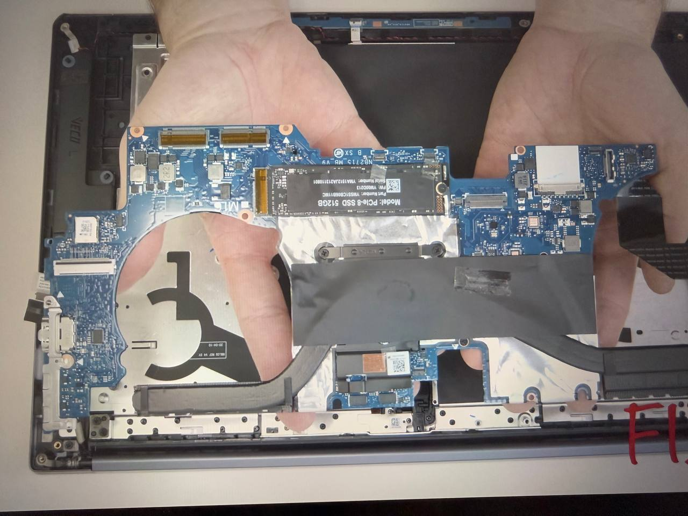
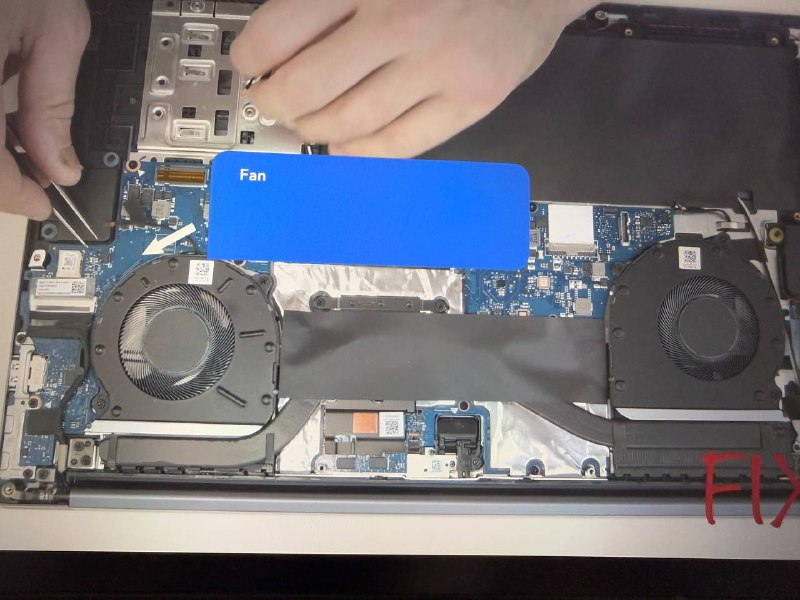
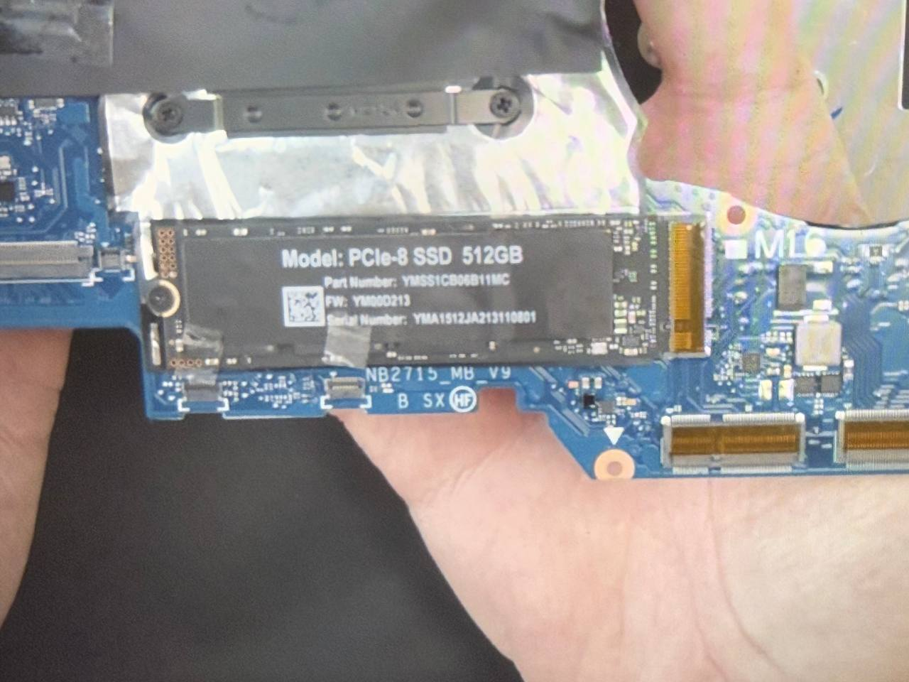
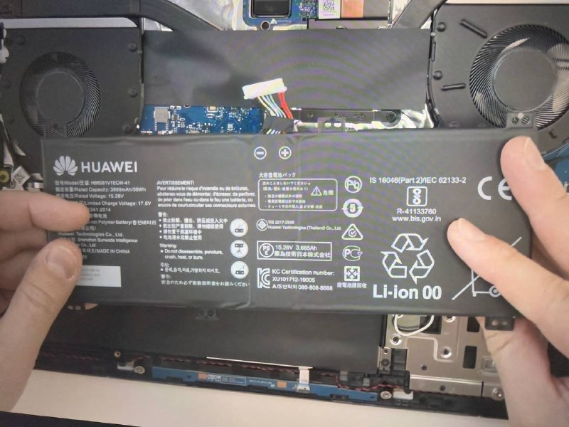

# Lab 3 — Teardown, and the same machine from the command line

Pair: None                     Driver first half: Moldir
Machine: Huawei MateBook D 16 (MCLF-XX)/VMware Ubuntu
Date: 30.10.2026

## What I did

1.Inspected physical hardware teardown components, identifying form factors, socket types, bus interfaces, and operational bottlenecks:
Identified the proprietary motherboard, BGA form factor, chipset, and supported CPU generations.
Examined the CPU thermal package, mounting mechanism, and cooling constraints.
Identified the soldered LPDDR4x RAM configuration and channel bandwidth.
Inspected the M.2 NVMe solid-state storage drive and interface bus.
Inspected the internal battery pack and DC power distribution.
2.Extracted host hardware specifications in Windows via PowerShell CIM queries:

```
PowerShell
Get-CimInstance Win32_Processor | Select-Object Name, NumberOfCores, NumberOfLogicalProcessors, MaxClockSpeed
Get-CimInstance Win32_PhysicalMemory | Select-Object Manufacturer, Capacity, Speed, DeviceLocator
Get-Disk | Select-Object Number, FriendlyName, Size, PartitionStyle

```
Booted the Ubuntu 24.04 guest virtual machine (⁠lab01⁠) in VMware and collected Linux hardware facts via Bash.
Saved CLI raw console outputs into ⁠evidence/windows-specs.txt⁠ and ⁠evidence/linux-specs.txt⁠.

```
lscpu
free -h
lsblk

```

## Result

1. Hardware Teardown Analysis
Component 1: Motherboard & Platform (Huawei MCLF-XX Mainboard)
<<<<<<< HEAD
 Image:
 
 Socket: BGA1744 (Ball Grid Array; the processor is permanently surface-mounted via solder balls, not socketed).
=======
 
Image:
 
Socket: BGA1744 (Ball Grid Array; the processor is permanently surface-mounted via solder balls, not socketed).
>>>>>>> 662ef70 (Fix comparison table formatting)
 Chipset: Intel Alder Lake-P Platform Controller Hub (integrated on package).
 Accepted CPU Generations: Factory-integrated 12th Gen Intel Core mobile processors only (Alder Lake-H/P architecture).
 Connects To: High-current multi-pin DC battery connector, eDP display ribbon cable, M.2 2280 NVMe storage slot, Type-C daughterboard, dual stereo speakers, and cooling assembly.
 Key Limitations:
 Zero modular expansion slots for CPU or RAM; no desktop socket or SO-DIMM slots are provided.
 The proprietary shape and screw mounting holes restrict the board strictly to this specific chassis model.
Component 2: CPU & Cooling System (Intel Core i5-12450H + Shark Fin Cooler)
<<<<<<< HEAD
 Image:
 
 Connects To: The processor die is soldered directly to the BGA pads beneath the heatsink. The dual copper heatpipe assembly attaches with spring-tensioned screws directly above the CPU thermal plate; dual blower fans connect via 4-pin PWM headers.
=======
 
Image:
 
Connects To: The processor die is soldered directly to the BGA pads beneath the heatsink. The dual copper heatpipe assembly attaches with spring-tensioned screws directly above the CPU thermal plate; dual blower fans connect via 4-pin PWM headers.
>>>>>>> 662ef70 (Fix comparison table formatting)
 Key Limitations:
 Base TDP is 45W with Maximum Turbo Power up to 95W; dynamic thermal throttling reduces sustained package power to ~40–45W under continuous heavy multi-threaded workloads.
 The CPU multiplier is factory-locked, preventing core clock overclocking.
Component 3: Storage (PCle-8 SSD 512GB)
<<<<<<< HEAD
 Image:
 Connects To: Motherboard M.2 2280 Key-M slot via PCIe lanes.
=======
 
Image:
 
Connects To: Motherboard M.2 2280 Key-M slot via PCIe lanes.
>>>>>>> 662ef70 (Fix comparison table formatting)
 Key Limitations:
 Maximum data transfer rate is constrained by the theoretical PCIe Gen4 x4 bus bandwidth (~8 GB/s).
 Thermal throttling under sustained sequential write operations inside a compact unvented laptop enclosure.
Component 4: Battery Pack (Li-ion Polymer Battery)

Image:

Connects To: Dedicated high-current DC battery harness connector on the lower edge of the motherboard.
Key Limitations:
Nominal energy capacity is ~60 Wh (11.46V).
Battery discharge current limits prevent the CPU from sustaining its peak 95W turbo frequencies when disconnected from the external USB-PD charger.

### 2. Multi-OS Command Comparison Table (Windows, Linux, macOS)

| Hardware Fact | Windows (PowerShell / CIM) | Linux (Bash) | macOS (Zsh / CLI) |
| :--- | :--- | :--- | :--- |
| **CPU Model & Clock** | `Get-CimInstance Win32_Processor \| Select-Object Name, MaxClockSpeed` | `lscpu \| grep "Model name"` | `sysctl -n machdep.cpu.brand_string` |
| **Cores & Threads** | `Get-CimInstance Win32_Processor \| Select-Object NumberOfCores, NumberOfLogicalProcessors` | `lscpu \| grep -E "^CPU\(s\):\|Thread\(s\) per core:"` | `sysctl -n hw.physicalcpu hw.logicalcpu` |
| **RAM Total & Available** | `Get-CimInstance Win32_OperatingSystem \| Select-Object TotalVisibleMemorySize, FreePhysicalMemory` | `free -h` | `sysctl -n hw.memsize` / `vm_stat` |
| **RAM Physical Modules** | `Get-CimInstance Win32_PhysicalMemory \| Select-Object Capacity, Speed, Manufacturer` | `sudo dmidecode -t memory` | `system_profiler SPMemoryDataType` |
| **Disk Partitions & Topology** | `Get-Disk` | `lsblk` | `diskutil list` |
| **Physical Disk Details** | `Get-PhysicalDisk \| Select-Object FriendlyName, MediaType, Size` | `sudo fdisk -l` | `system_profiler SPStorageDataType` |


## What did not work for the first time

When attempting to launch the Ubuntu virtual machine (⁠lab01⁠) inside VMware Workstation, startup failed with: ⁠"This virtual machine appears to be in use. Taking ownership failed".
Cause: Leftover lock directories (⁠.lck⁠) remained inside ⁠C:\Users\Huawei\Documents\Virtual Machines\lab01\⁠ following an ungraceful host shutdown.
Fix: Closed VMware Workstation completely, browsed to the VM directory in File Explorer, deleted all ⁠.lck⁠ directories, and restarted the virtual machine cleanly.

## Evidence

- [evidence/photos/](evidence/photos/) — Hardware teardown photos verifying the physical motherboard, CPU/cooling assembly, M.2 SSD, and battery pack.
- [evidence/windows-specs.txt](evidence/windows-specs.txt) — Raw PowerShell CIM output proving host hardware specifications (i5-12450H CPU, 16 GB LPDDR4x RAM, and WD PC SN740 SSD).
- [evidence/linux-specs.txt](evidence/linux-specs.txt) — Raw Bash command output (lscpu, free -h, lsblk) demonstrating system identification from within the Ubuntu virtual machine.
