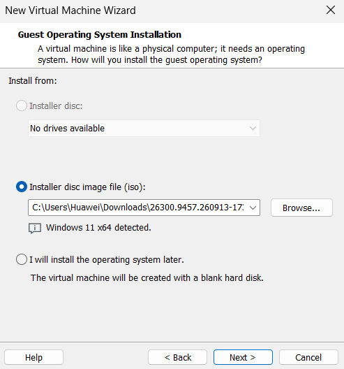
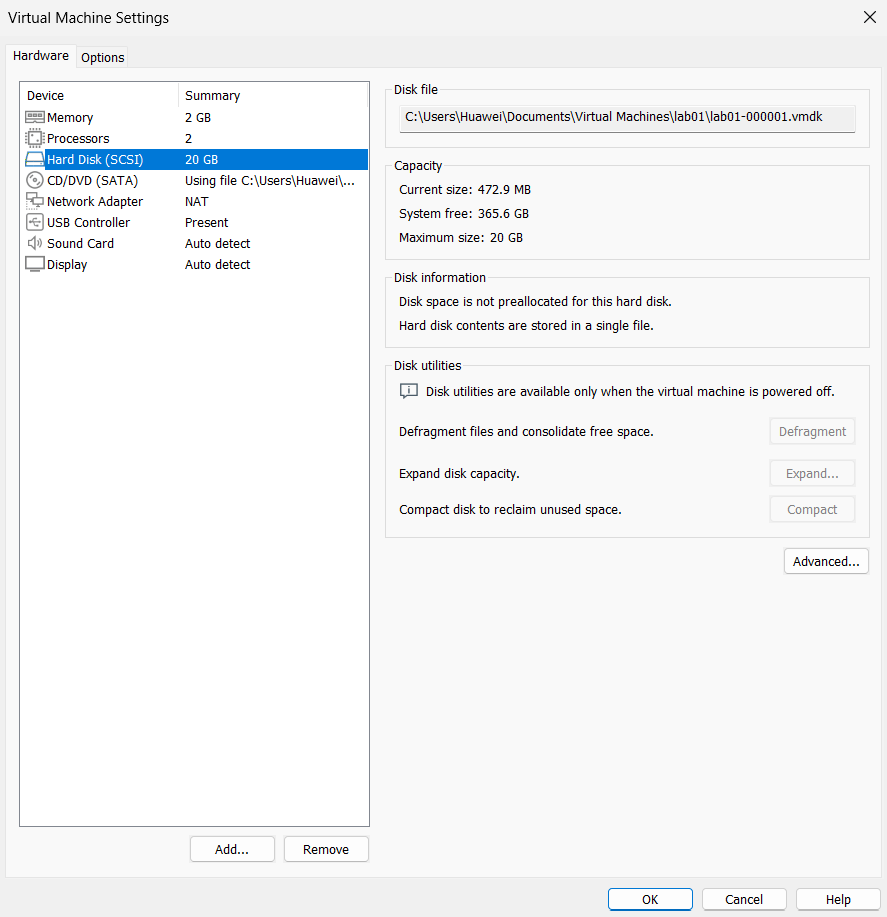
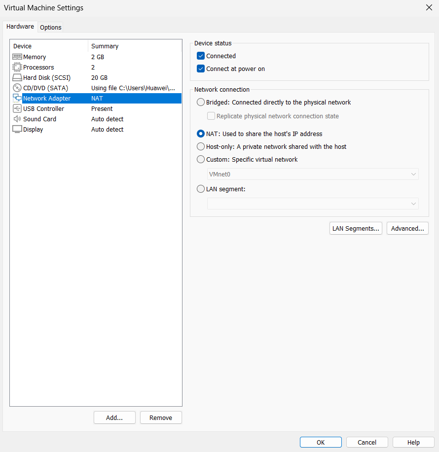

# BUILD.md — Step-by-Step Environment Build Guide (Ticket 1)

This guide provides a comprehensive, step-by-step procedure to set up a developer sandbox environment from scratch using VMware Workstation. Follow every step in sequential order.

```

## 1. Prerequisites

Ensure you have the following before starting:
- **Hypervisor:** VMware Workstation Pro installed on the Windows host.
- **Operating System ISOs:**
  - Ubuntu Server LTS (24.04 or 22.04) 64-bit ISO.
  - Windows 11 64-bit ISO.
- **Hardware Capacity:** Sufficient free host SSD storage (at least 70–80 GB free) and available RAM (at least 8–16 GB total) to run both guest machines without host memory swapping.
- **BIOS/UEFI:** Hardware virtualization (Intel VT-x or AMD-V) enabled on the host.

```

## 2. Primary Linux Guest Setup (`lab01` — Ubuntu Server)

### Step 1. Initialize the Virtual Machine Wizard
1. Open **VMware Workstation**.
2. Go to **File** -> **New Virtual Machine...** (or press `Ctrl + N`).
3. Select **Typical (recommended)** and click **Next**.
4. Select **Installer disc image file (iso)**, click **Browse...**, select your Ubuntu Server ISO file, and click **Next**.
5. Set the Virtual machine name to `lab01` and choose a location on your SSD. Click **Next**.



*Why this option:* The Typical configuration provides a straightforward setup with standard virtual hardware options. It is suitable for creating a basic Linux virtual machine without configuring unnecessary virtual components manually.

> **Check:** Confirm that the wizard summarizes the VM name as `lab01` and identifies the 64-bit guest operating system.

```

### Step 2. Configure Virtual Disk Storage
1. In VMware, open **Edit virtual machine settings** (`Ctrl + D`) for `lab01`.
2. Under the Hardware tab, select **Hard Disk (SCSI)**.
3. Set **Maximum size (GB)** to `20.0 GB`.
4. Select **Store virtual disk as a single file**, and leave "Allocate all disk space now" unchecked (thin provisioning). Click **OK**.



*Why 20 GB and thin provisioning:*
- A 20 GB capacity provides sufficient disk space for the base Ubuntu Server installation, core development utilities, and log files.
- Thin provisioning ensures the virtual disk file (`.vmdk`) only consumes space on the host drive as files are written inside the guest, saving host storage.

> **Check:** In the Hard Disk panel, confirm that `Maximum size` displays `20 GB` and the disk file path ends in `.vmdk`.

```

### Step 3. Configure Virtual RAM and vCPU
1. In **Virtual Machine Settings**, click on **Memory**.
2. Set Memory to **2048 MB** (2 GB).
3. Click on **Processors**.
4. Set Number of processors to `1` and Number of cores per processor to `2` (Total processor cores: `2`). Click **OK**.

*Why this allocation:* 2 GB RAM and 2 vCPUs are sufficient to run a lightweight headless Ubuntu Server comfortably, leaving the remaining host RAM and CPU threads available for the Windows 11 guest and the host system.

> **Check:** Confirm that the Hardware list shows `Memory: 2 GB` and `Processors: 2`.

```

### Step 4. Configure Virtual Network Adapter
1. In **Virtual Machine Settings**, select **Network Adapter**.
2. Under "Device status", ensure **Connected** and **Connect at power on** are checked.
3. Under "Network connection", select **NAT: Used to share the host's IP address**.
4. Click **OK**.



*Why NAT mode:*
On institutional and campus networks, port security policies filter external traffic by physical MAC address. A Bridged adapter assigns the VM its own unique MAC, causing network switches to block communication or drop DHCP requests. Under NAT, outgoing traffic shares the host's authenticated address. Note that selecting NAT configures the virtual adapter, but full guest-to-guest visibility requires an explicit verification test.

> **Check:** Verify that the summary beside Network Adapter in the settings list reads `NAT`.

```

### Step 5. Operating System Installation (Ubuntu Server)
1. Power on the `lab01` virtual machine.
2. Select **Try or Install Ubuntu Server** and press `Enter`.
3. Complete the interactive installation steps:
   - **Language & Keyboard:** Select `English` and your preferred layout (`English (US)`).
   - **Installation Type:** Select standard `Ubuntu Server`.
   - **Network Connections:** Ensure the network interface acquires an IP automatically via DHCP from VMware's NAT engine.
   - **Configure Storage:** Select `Use an entire disk` (the 20 GB SCSI disk). Review the partition layout and select `Done` -> `Continue`.
   - **Profile Setup:** Enter your name, set the server's name to `lab01`, create a username (e.g. `devuser`), and configure a password.
   - **SSH Setup:** Check `Install OpenSSH server` to enable remote management.
   - **Featured Server Snaps:** Leave unselected and proceed with `Done`.
4. Wait for the installer to finish downloading security updates, select **Reboot Now**, and press `Enter` when prompted to remove the installation media.

> **Check:** Upon reboot, verify that the console presents the `lab01 login:` prompt.

```

### Step 6. Post-Install Verification & Kernel Output
1. Log in to `lab01` using your configured username and password.
2. Retrieve the active kernel version and save it into the evidence catalog:
   ```bash
   uname -a > evidence/04-guest-uname.txt
   cat evidence/04-guest-uname.txt


```

3. Check the assigned dynamic IP address:
```bash
ip addr

```


Note the assigned IPv4 address on the primary interface.
4. Verify outbound internet connectivity:
```bash
ping -c 4 8.8.8.8

```


*Why this step matters:* This verifies that the Linux kernel is running properly, the network interface is up with an active DHCP lease, and external routing works.

> **Check:** Open `evidence/04-guest-uname.txt` and ensure it contains the active 64-bit Linux kernel string. The ping output should show 0% packet loss.

```

## 3. Secondary Windows Guest Setup (Windows 11)

To support dual-platform testing, set up a secondary Windows 11 virtual machine:

1. **VM Wizard:** Click `File` -> `New Virtual Machine...` -> `Typical`. Select the Windows 11 ISO. Choose **UEFI** firmware with **Secure Boot** enabled.
2. **Hardware Specs:** Allocate **4096 MB RAM**, **2 vCPUs**, and **50 GB** disk capacity (thin-provisioned).
3. **Network Mode:** Set the Network Adapter to **NAT** so it connects to the same VMware virtual NAT switch.
4. **OS Installation:** Complete the Windows setup wizard and create a local test user account.
5. **Verify IP:** Open Command Prompt (`cmd.exe`) in Windows and run `ipconfig`. Note the IPv4 address assigned to the virtual adapter.

> **Check:** Verify that both the Linux guest and the Windows guest are running concurrently and each holds an IP address on the VMware NAT subnet.

```

## 4. Network Connectivity Verification

Verify that both virtual machines can reach the internet and communicate with each other bidirectionally:

1. **Internet Access from Linux (`lab01`):**
```bash
ping -c 4 8.8.8.8

```


*Expected:* 4 packets transmitted, 4 received, 0% packet loss.
2. **Windows to Linux (`lab01`) Ping:**
In Windows Command Prompt, ping the Linux VM:
```cmd
ping <lab01-ip-address>

```


*Expected:* 4 replies received, 0% loss.
3. **Linux to Windows Ping:**
Windows Defender Firewall blocks incoming ICMP echo requests by default. In the Windows guest, open PowerShell as Administrator and run:
```powershell
netsh advfirewall firewall add rule name="Allow ICMPv4-In" protocol=icmpv4:8,any dir=in action=allow

```


From the `lab01` console, ping the Windows guest:
```bash
ping -c 4 <windows-ip-address>

```


*Expected:* 4 packets transmitted, 4 received, 0% packet loss.
4. Save the full logs of these tests into `evidence/05-ping-between-guests.txt`.

> **Check:** Ensure all sections in `evidence/05-ping-between-guests.txt` demonstrate 0% packet loss.

```

## 5. Baseline Snapshot Creation

Create a clean recovery point before handing over the environment:

1. Select `lab01` in the VMware Workstation library.
2. Go to **VM** -> **Snapshot** -> **Take Snapshot...** (or press `Ctrl + Shift + T`).
3. Set the Name to `clean-install`.
4. Enter a brief description: `Baseline clean installation with verified network connectivity.`
5. Click **Take Snapshot**.
6. Open **VM** -> **Snapshot** -> **Snapshot Manager** (`Ctrl + M`) to review the tree.

*Why take a snapshot:* The ticket requires an environment where experiments can run without breaking anything. A baseline snapshot allows instant rollback if testing corrupts configurations or packages.

> **Check:** In Snapshot Manager, verify that `clean-install` appears in the snapshot tree and the marker indicates `You Are Here`.

```

```